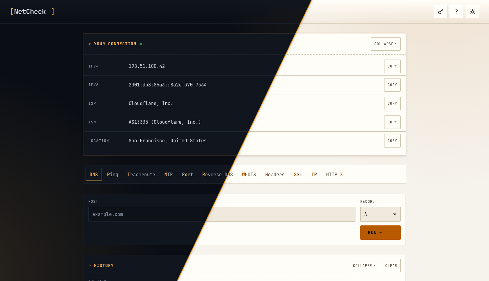

# NetCheck


NetCheck is a self-hosted network diagnostic app designed to run probes without leaking your origin IP address. It gives you distributed ping, traceroute, MTR, port testing, and SSL checks from vantage points around the globe, plus native DNS and WHOIS tools running directly on your box.

Everything is packed into a single, statically linked Go binary running inside a bare `scratch` container. No Python, no package managers, and no persistent disk dependencies.



---

## Why Run NetCheck?

When you run network tests from browser-based tools or shell scripts on your server, you hit a few common headaches:

1. **Origin IP Exposure:** Running active scans or pings against remote servers exposes your personal IP or datacenter CIDR. Target firewalls log your box, IDS/IPS rules flag your IP, and rate limiters kick in.
2. **One-Sided Routing:** Testing from your single server tells you what routes look like from *your* machine, not how real users across Europe, Asia, or South America reach your service.
3. **Split-Tunnel VPN Leaks:** Standard lookups often mask broken dual-stack configs where your IPv4 rides the VPN while your IPv6 leaks out your physical ISP connection.

NetCheck splits the job cleanly:
- **Public Network Tests:** Heavy diagnostics (Ping, Traceroute, MTR, TCP Port, SSL certificates, HTTP headers) are dispatched through edge probes on the **Globalping** network. Remote hosts see Globalping nodes; your home or server IP stays hidden.
- **Local Network Tests:** DNS queries, Reverse DNS (PTR), and WHOIS/RDAP queries run directly from your server.
- **Homelab Mode:** If you need to troubleshoot local routers, switches, or internal hosts, turn on `ALLOW_PRIVATE_TARGETS=1` to run local scans against RFC 1918 subnets.

---

## The v2.0 Architecture (Python vs Go)

NetCheck started as a FastAPI app on Python 3.11 with SQLite caching. It worked, but keeping Python running at idle took 48MB of RAM and required disk mounts just to cache domain queries. 

With v2.0.0, we rewrote the entire backend in Go 1.27:

| Metric | NetCheck v1 (Python) | NetCheck v2 (Go) | Why it matters |
| :--- | :--- | :--- | :--- |
| **Container Size** | 33.8 MB (Alpine multi-stage) | **8.5 MB (`scratch`)** | 75% smaller; pulls in seconds |
| **Idle Memory** | ~48 MB RAM | **~7.6 MB RAM** | Runs on cheap VPS boxes and tiny homelab SBCs |
| **Base Image** | Alpine Linux + musl + gosu | **`scratch`** | No shell, no package manager, no OS attack surface |
| **User ID** | UID 1000 | **UID 10001 (unprivileged)** | Hardened least-privilege execution |
| **Filesystem** | Writable `/data` (SQLite cache) | **`read_only: true`** | Fully stateless; zero disk volume mounts required |
| **Concurrency** | AnyIO threadpool workers | **Native Go goroutines** | Lightweight scheduling with zero thread overhead |
| **Cache Storage** | SQLite on disk (`diskcache`) | **In-memory LRU (`singleflight`)** | Zero disk locks, sub-microsecond cache hits |

---

## What Is Inside

### Distributed Edge Probes (Globalping)
- **Multi-Hop Traceroute & MTR:** Hop-by-hop latency discovery with packet loss statistics and PTR hostnames.
- **ICMP Ping:** Packet loss detection and min/avg/max round-trip timings.
- **TCP Port Testing:** Connect checks across common and custom ports to verify listening services and firewall rules.
- **SSL / TLS Inspector:** Certificate expiration countdown, SAN list, issuer verification, and validity dates.
- **HTTP/HTTPS Checker:** Inspect status codes, response headers, redirects, and TLS negotiation.
- **Probe Regions:** Filter probe location by Worldwide, North America (NA), Europe (EU), Asia (AS), South America (SA), Africa (AF), or Oceania (OC).

### Native Local Diagnostics
- **DNS Engine:** Powered by `codeberg.org/miekg/dns` v2. Resolves 14 record types (A, AAAA, MX, NS, CNAME, TXT, SOA, CAA, SRV, PTR, HTTPS, SVCB, DNSKEY, DS). Uses a 1232-byte EDNS0 buffer to prevent UDP fragmentation and automatically retries over TCP when responses are truncated.
- **Reverse DNS (PTR):** Resolves IPv4 `in-addr.arpa` and IPv6 `ip6.arpa` pointer records.
- **WHOIS & RDAP:** Queries RDAP REST APIs (`rdap.org`) first, then falls back to a two-hop port-43 query (`whois.iana.org` -> authoritative registry). Results are cached in an in-memory LRU cache (5,000 domains, 12h TTL) protected by Go's `singleflight.Group` to prevent cache stampedes.
- **Dual-Stack Egress Check:** Concurrent IPv4 and IPv6 detection via Cloudflare Anycast (`icanhazip.com`) with fallback to `ipify.org`, displaying your ASN and organization.
- **IP Ownership & Geolocation:** ASN, ISP, and country metadata lookup.

### Web Interface
- **Vanilla Frontend:** Native ES6 modules, zero bundlers, zero npm dependencies.
- **Embedded Assets:** HTML, CSS, JavaScript, and variable fonts (JetBrains Mono WOFF2) are baked directly into the binary with Go's `embed.FS`.
- **Keyboard Shortcuts:** Switch tools and trigger lookups without touching the mouse (`?` opens shortcut help).

---

## Quickstart

### Docker Compose (Recommended)

Save this as `docker-compose.yml`:

```yaml
services:
  netcheck:
    image: nnt25/netcheck:latest
    container_name: netcheck
    restart: unless-stopped
    ports:
      - "7070:7070"
    read_only: true
    security_opt:
      - no-new-privileges:true
    cap_drop:
      - ALL
    # environment:
    #   - PORT=7070
    #   - AUTH_TOKEN=your-random-token-here
    #   - ALLOW_PRIVATE_TARGETS=0
    #   - TRUSTED_PROXIES=127.0.0.1,::1,172.16.0.0/12,10.0.0.0/8,192.168.0.0/16
    #   - GLOBALPING_TOKEN=your-token-from-globalping
```

Fire it up:

```bash
docker compose up -d
```

Open your browser to `http://localhost:7070`.

### Docker CLI

```bash
docker run -d \
  --name netcheck \
  -p 7070:7070 \
  --read-only \
  --cap-drop=ALL \
  --security-opt=no-new-privileges:true \
  nnt25/netcheck:latest
```

---

## Configuration Reference

Configure NetCheck by passing environment variables to the container:

| Variable | Default | Purpose |
| :--- | :--- | :--- |
| `PORT` | `7070` | Port the internal HTTP server binds to. |
| `AUTH_TOKEN` | unset | When set, requires `Authorization: Bearer <token>` on all `/api/*` endpoints. |
| `ALLOW_PRIVATE_TARGETS` | `0` | SSRF protection switch. `0` blocks RFC 1918 and loopback targets. `1` allows homelab and LAN scanning. |
| `TRUSTED_PROXIES` | `127.0.0.0/8,10.0.0.0/8,172.16.0.0/12,192.168.0.0/16,::1/128,fc00::/7` | Subnets permitted to pass client IP headers (`CF-Connecting-IP`, `X-Forwarded-For`). For Cloudflare Tunnel (`cloudflared`) or local proxies, include loopback and Docker subnets. |
| `RATE_LIMIT_RPM` | `60` | Token-bucket rate limit per client IP (requests/minute). Set to `0` or `off` to disable completely (unlimited). |
| `RATE_LIMIT_BURST` | `20` | Maximum burst capacity allowed above the steady-state rate. |
| `ALLOWED_ORIGINS` | empty | CORS allowed origins (comma-separated). Empty enforces same-origin. |
| `GLOBALPING_TOKEN` | unset | Optional Globalping API token to bump your hourly probe limits. |
| `GLOBALPING_API` | `https://api.globalping.io/v1` | Custom endpoint URL for Globalping API calls. |
| `NETCHECK_VERSION` | unset | Custom version string sent in outbound `User-Agent` headers. |
| `IPWHOIS_API_KEY` | unset | Optional commercial API key for `ipwho.is` lookups. |

---

## Security Architecture

NetCheck is built with a defense-in-depth model for public or homelab use:

1. **SSRF Evasion Protection:** Standard IP parsers fail on octal or hex IPv4 representations (`0177.0.0.1`, `0x7f.0.0.1`, `2130706433`). Our custom `ParseLooseIPv4` engine parses non-standard inputs, canonicalizes them, and filters them against RFC 1918, RFC 4291 (IPv4-mapped IPv6), CGNAT, and loopback ranges before any socket dials.
2. **Zero-TOCTOU Custom Dialer:** `SSRFDialContext` resolves domain names and dials the validated IP directly, killing DNS rebinding attacks at the socket layer.
3. **Timing-Safe Auth:** Token verification runs through `crypto/subtle.ConstantTimeCompare` to avoid timing side-channel leaks.
4. **Rate Limiting:** Built-in token bucket (`golang.org/x/time/rate`) gives each client IP 10 requests per minute with a burst of 5. Inactive records get evicted every 10 minutes to keep memory clean.
5. **Read-Only Scratch Container:** The production image contains only the statically linked binary, CA certificates, and a minimal `/etc/passwd`. No shell, no root permissions, and no write access to disk.

---

## Local Development

Prerequisites: Go 1.27+

```bash
# Clone the repository
git clone https://github.com/sudo-Penguin-Lalala/netcheck.git
cd netcheck

# Run tests with race detection
go test -v -race ./...

# Build the statically linked binary
CGO_ENABLED=0 go build -ldflags="-s -w" -trimpath -o netcheck .

# Start the server locally
./netcheck
```

---

## License

NetCheck is open source software released under the **GNU Affero General Public License v3.0 (AGPL-3.0)**. See the [LICENSE](./LICENSE) file for details.
