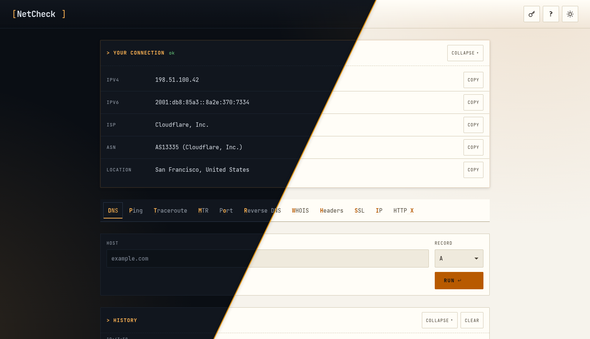

# NetCheck


> Self-hosted network diagnostic toolkit engineered for origin-leak-free diagnostics, split-tunnel VPN validation, dual-stack reachability, and distributed probe telemetry.



---

## Why NetCheck?

Standard web-based diagnostic utilities (such as `ping.eu`, `mxtoolbox`, or `centralops.net`) execute tests directly from their centralized origin servers. For network engineers, sysadmins, and homelab operators, this introduces critical operational constraints:

1. **Origin Egress Exposure:** Probing external endpoints directly from your own IP reveals your infrastructure address space, triggering intrusion detection systems (IDS/IPS), CDN bot mitigation, and firewall rate-limiting.
2. **False Positives in Egress Routing:** Traditional tests cannot determine how a service appears from diverse autonomous systems across the public internet.
3. **Undetected Tunnel Leaks:** Naive single-stack lookups fail to expose broken IPv6 split-tunneling, DNS hijacking, or VPN leaks where the tunnel claims connection while real traffic bleeds through the ISP gateway.

NetCheck resolves this by decoupling telemetry collection from the local host:
- **Public Probes:** Active measurements (Ping, Traceroute, MTR, TCP Port reachability, SSL verification, HTTP inspection) are dispatched through the globally distributed **Globalping** probe network. Targets only observe third-party edge vantage points—your origin IP is never exposed.
- **Local Diagnostics:** Passive and local queries (DNS resolution, reverse DNS PTR, WHOIS registry querying, dual-stack egress verification) execute securely on your host.
- **Internal LAN / Homelab Mode:** When troubleshooting private infrastructure, NetCheck natively scans RFC1918 subnets and internal services without forwarding traffic upstream.

---

### Engineering Comparison

| Capability | NetCheck | ping.eu / CentralOps | MXToolbox |
| :--- | :--- | :--- | :--- |
| **Deployment Model** | **Self-hosted** (Docker / OCI container) | Centralized SaaS | Centralized SaaS |
| **Active Probe Origin** | **Decoupled edge probes** (Globalping) | Direct centralized server | Direct centralized server |
| **Origin IP Masking** | **Zero host IP exposure** | Host IP visible in logs | Host IP visible in logs |
| **Dual-Stack Inspection** | **Concurrent IPv4 + IPv6 + ASN** | Single-stack / split | Fragmented across pages |
| **Private LAN / Homelab** | **Native fallback** (`ALLOW_PRIVATE_TARGETS=1`)| Not supported | Not supported |
| **Privacy Architecture** | **Zero-log default** (`ACCESS_LOG=0`), no DB | Analytics & tracking | Commercial ads & trackers |
| **Tool Integration** | **11 diagnostic tools in one interface** | Fragmented | Scattered across tabs |
| **Licensing** | **AGPL-3.0 Open Source** | Proprietary | Proprietary |

---

## Live Demo

A public demonstration instance is accessible at: **[netcheck.nnt25.io.vn](https://netcheck.nnt25.io.vn)**

> [!NOTE]
> **Privacy Architecture:** The public demo runs with strict zero-logging (`ACCESS_LOG=0`). Query parameters, target addresses, and diagnostic outputs are held in browser memory and local storage (`localStorage`) only. No queries or connection records are persisted to disk or external databases. For complete administrative control, deploy your own instance.

---

## Key Capabilities

### Distributed Edge Probes (Globalping Network)
- **Multi-Hop Traceroute & MTR:** Real-time path discovery with per-hop packet loss, round-trip time (min/avg/best/worst), and reverse PTR resolution.
- **ICMP Ping Telemetry:** High-precision latency diagnostics with configurable packet count and sequence loss percentages.
- **TCP Port Audit:** Non-intrusive TCP handshakes identifying open, closed, or filtered states across canonical and custom service ports.
- **SSL / TLS Certificate Inspector:** Complete chain validation, subject alternative names (SANs), expiration countdown, and certificate validity verification.
- **HTTP/HTTPS Header & Response Checker:** Protocol inspection surfacing status codes, redirects (Location headers), response headers, and TLS handshake state.
- **Probe Region Targeting:** Dynamically target probes from **Worldwide** (default), **North America (NA)**, **Europe (EU)**, **Asia (AS)**, **South America (SA)**, **Africa (AF)**, or **Oceania (OC)**.

### Local & Core Network Diagnostics
- **Dual-Stack Egress Resolution:** Simultaneous IPv4 and IPv6 public address detection powered by Cloudflare Anycast (`icanhazip.com`) with automated fallback, accompanied by autonomous system (`ASN + Organization`) and geographic attribution. Immune to browser tracking protection and adblock filters.
- **DNS Resolver:** Query A, AAAA, CNAME, HTTPS (RFC 9460), SVCB, MX, TXT, NS, SOA, PTR, CAA, SRV, DNSKEY, and DS records directly with TTL and upstream nameserver attribution.
- **Reverse DNS (PTR):** Validate forward-confirmed reverse DNS (FCrDNS) mapping.
- **Resilient WHOIS & RDAP:** Multi-tier registry lookup featuring modern **RDAP REST protocol (RFC 7480-7484)**, standard library querying, and authoritative port-43 TCP socket referral chaining (`whois.iana.org`).
- **IP Ownership & Geolocation:** Detailed ASN, CIDR, ISP, organization, and geographic metadata with transparent upstream failover.
- **Client Header Reflection:** Fast inspection of incoming HTTP headers passed through reverse proxies and edge CDNs.

### Homelab & Private Subnet Troubleshooting
- **RFC1918 / Loopback Mode:** When `ALLOW_PRIVATE_TARGETS=1` is set, active tools seamlessly fall back to local execution (non-blocking TCP socket connect for port audits, local ICMP ping, and direct HTTP probes). Self-signed SSL certificates are gracefully handled for router and switch management portals.

### High-Performance Backend Engineering
- **HTTP Connection Pooling:** Lifespan-managed `httpx.AsyncClient` reusing persistent connections across third-party endpoints, eliminating TCP and TLS handshake overhead.
- **Adaptive Low-Latency Polling:** Progressive probe polling schedule (`0.2s` to `1.0s`) cutting average measurement latency by **60–75%**.
- **Wire Compression:** Integrated GZip compression reducing response payloads by up to **76%** on heavy diagnostic outputs (MTR, WHOIS).
- **Route-Aware Caching:** Immutable 24-hour cache headers for static UI assets paired with strict `no-store` policies on dynamic `/api/*` routes.

### Terminal-Style Interface
- **Monospace Design System:** High-contrast Dark and Light themes with subtle micro-interactions and self-hosted JetBrains Mono WOFF2 variable fonts (~49KB) for 100% air-gapped, zero-CDN privacy.
- **Zero-Build Native ES Architecture:** Pure native browser ES modules without bundlers, node_modules, or build pipelines.
- **Zero-FOUC State Hydration:** Early script execution prevents flash of unstyled content and remembers card collapsed/expanded states across refreshes.
- **Full Keyboard Navigation:** Global hotkeys for switching diagnostic tabs and initiating queries (`?` displays shortcut modal).
- **Shareable State & History:** Deep-link queries encoded directly into URL fragments; recent test runs stored in client-side FIFO history.

---

## Quick Start

### Option 1: Docker CLI (Fastest)

```bash
docker run -d -p 7070:7070 --name netcheck nnt25/netcheck:latest
```

Navigate to: **`http://localhost:7070`**

### Option 2: Docker Compose (Recommended)

Save as `docker-compose.yml`:

```yaml
services:
  netcheck:
    image: nnt25/netcheck:latest
    container_name: netcheck
    restart: unless-stopped
    ports:
      - "7070:7070"
    environment:
      - ACCESS_LOG=0
      # - AUTH_TOKEN=your-random-32-char-token-here
      # - ALLOW_PRIVATE_TARGETS=0
      # - TRUSTED_PROXIES=127.0.0.1,172.16.0.0/12
      # - RATE_LIMIT=10/minute
      # - GLOBALPING_TOKEN=your-globalping-token
```

Launch the container:

```bash
docker compose up -d
```

---

## Configuration Reference

All settings are configured via environment variables:

| Variable | Default | Description |
| :--- | :--- | :--- |
| `ACCESS_LOG` | `0` | Controls access logging. `0` disables IP/request logging entirely; `1` enables Uvicorn logs. |
| `AUTH_TOKEN` | unset | Static bearer token. When set, all `/api/*` endpoints require `Authorization: Bearer <token>`. |
| `ALLOW_PRIVATE_TARGETS` | `0` | SSRF security gate. `0` blocks RFC1918/loopback targets; `1` enables private subnet scanning. |
| `TRUSTED_PROXIES` | `127.0.0.1,172.16.0.0/12` | CIDR blocks trusted to supply real client IPs via `X-Forwarded-For`. Never set to `*`. |
| `RATE_LIMIT` | `10/minute` | Per-client rate limit budget. Format: `<count>/<second\|minute\|hour\|day>`. |
| `ALLOWED_ORIGINS` | empty | CORS policy. Empty enforces same-origin; `*` allows all origins. |
| `GLOBALPING_TOKEN` | unset | Optional Globalping API token raising probe quota from 250 to 500+ measurements/hour. |
| `GLOBALPING_API` | `https://api.globalping.io/v1` | Override base URL for Globalping API calls. |
| `NETCHECK_VERSION` | unset | Optional runtime version string (defaults to release tag) formatted into dynamic RFC 9110 `User-Agent` telemetry headers. |
| `IPWHOIS_API_KEY` | unset | Optional API key for upgraded commercial limits on `ipwho.is`. |
| `CACHE_DIR` | `/data/netcheck-cache` | Directory path for persistent cache storage. |

---

## Security Architecture

NetCheck is built with a defense-in-depth posture:

- **Strict SSRF Isolation:** By default (`ALLOW_PRIVATE_TARGETS=0`), targets resolving to private, loopback, link-local, multicast, or reserved ranges are rejected with HTTP 403 before any network socket is opened.
- **DNS Rebinding Mitigation:** Target hostnames undergo dual-resolution consistency verification with delay-jitter. Rebinding attempts or suspicious IP disjoints are rejected (fail-closed) with CDN GeoDNS pool heuristics.
- **IPv6-Mapped IPv4 Normalization:** Addresses utilizing IPv4-mapped IPv6 syntax (`::ffff:127.0.0.1`) are extracted and subjected to identical RFC1918 filtering.
- **Timing-Safe Authentication:** Bearer token validation utilizes constant-time digest comparison (`secrets.compare_digest`) to prevent timing side-channel attacks.
- **Header Sanitization:** Sensitive authentication and cookie headers (`Authorization`, `Cookie`, `Proxy-Authorization`) are stripped and never echoed by the `/api/headers` reflection tool.
- **Information Disclosure Prevention:** Server exception details and internal stack traces are suppressed in user-facing JSON payloads and logged strictly server-side.
- **Non-Root Execution:** Container runs under unprivileged user `netcheck` (`uid: 1000`).

---

## Deployment Topologies

Detailed configuration templates and threat models are documented in [SECURITY.md](./SECURITY.md) and [DEPLOY.md](./DEPLOY.md).

| Topology | Target Use Case | Recommended Security Configuration |
| :--- | :--- | :--- |
| **A: Host Local** | Single workstation diagnostic utility | `ALLOW_PRIVATE_TARGETS=1`, `TRUSTED_PROXIES=` |
| **B: Internal Homelab** | LAN diagnostic server for local subnets | `AUTH_TOKEN=<secret>`, `ALLOW_PRIVATE_TARGETS=1` |
| **C: Reverse Proxy (Caddy / Nginx)** | Secure edge HTTPS termination | `TRUSTED_PROXIES=127.0.0.1`, `ALLOW_PRIVATE_TARGETS=0` |
| **D: Cloud / CDN Edge (Cloudflare)** | Public or team access via Zero Trust | `AUTH_TOKEN=<secret>`, `TRUSTED_PROXIES=<CDN-IPs>` |
| **E: Public Demo Instance** | Public unauthenticated utility | `ALLOW_PRIVATE_TARGETS=0`, `RATE_LIMIT=5/minute` |
| **F: Kubernetes Cluster** | Ingress-routed container deployment | `AUTH_TOKEN=<secret>`, `TRUSTED_PROXIES=10.0.0.0/8` |

---

## REST API Specification

Probe-style endpoints accept an optional `location` parameter (`world`, `NA`, `EU`, `AS`, `SA`, `AF`, `OC`).

| Method | Endpoint | Payload / Query | Output Summary | Telemetry Origin |
| :--- | :--- | :--- | :--- | :--- |
| `GET` | `/api/ip` | — | Egress IPv4/IPv6, ISP, ASN, GeoIP | Direct (Local host) |
| `GET` | `/api/ip-lookup` | `?ip=<target>` | Autonomous system, ISP, geolocation | Direct (Local host) |
| `POST` | `/api/dns` | `{"host": "...", "type": "A"}` | Resource records, TTL, upstream resolver | Direct (Local resolver) |
| `POST` | `/api/rdns` | `{"ip": "..."}` | Reverse PTR hostname resolution | Direct (Local resolver) |
| `POST` | `/api/whois` | `{"target": "..."}` | Registrar, creation, expiry dates, raw WHOIS | Direct (RDAP REST / authoritative port 43) |
| `GET` | `/api/headers` | — | Echo of incoming HTTP request headers | Local loopback |
| `POST` | `/api/ping` | `{"host": "...", "count": 4}` | RTT (min/avg/max), packets sent/recv, loss % | **Globalping Probe** |
| `POST` | `/api/traceroute` | `{"host": "...", "max_hops": 30}` | Path hops, intermediate router IPs, latency | **Globalping Probe** |
| `POST` | `/api/mtr` | `{"host": "..."}` | Integrated ping + traceroute loss telemetry | **Globalping Probe** |
| `POST` | `/api/port` | `{"host": "...", "port": 443}` | Port state (`open`, `closed`, `timeout`) | **Globalping Probe** |
| `POST` | `/api/ssl` | `{"host": "...", "port": 443}` | Certificate validity, issuer, SANs, days left | **Globalping Probe** |
| `POST` | `/api/http` | `{"url": "https://..."}` | Response code, latency, headers, TLS validity | **Globalping Probe** |
| `GET` | `/api/healthz` | — | Service health and authentication requirement | Local loopback |

---

## Reverse Proxy Reference

### Caddy (Recommended)

```caddyfile
netcheck.example.com {
    reverse_proxy 127.0.0.1:7070
}
```

Set `TRUSTED_PROXIES=127.0.0.1` in NetCheck.

### Nginx

```nginx
server {
    listen 443 ssl http2;
    server_name netcheck.example.com;

    ssl_certificate     /etc/ssl/certs/netcheck.crt;
    ssl_certificate_key /etc/ssl/private/netcheck.key;

    location / {
        proxy_pass         http://127.0.0.1:7070;
        proxy_set_header   Host $host;
        proxy_set_header   X-Real-IP $remote_addr;
        proxy_set_header   X-Forwarded-For $proxy_add_x_forwarded_for;
        proxy_set_header   X-Forwarded-Proto $scheme;
        proxy_read_timeout 60s;
    }
}
```

Set `TRUSTED_PROXIES=127.0.0.1` in NetCheck.

---

## Repository Layout

```
netcheck/
├── backend/
│   ├── main.py             # FastAPI entrypoint, lifespan client, security headers, GZip
│   ├── routers/            # Modular endpoint handlers (12 diagnostic routes)
│   ├── services/           # Business logic (RDAP REST & fallback WHOIS resolution)
│   ├── utils/              # Validators, rate limiting, Globalping client, connection pool
│   ├── tests/              # Automated unit and security regression test suite
│   └── requirements.txt
├── frontend/
│   ├── fonts/              # Self-hosted JetBrains Mono variable fonts (WOFF2)
│   ├── src/                # Modular Native ES6 architecture (core, formatters, runners, ui)
│   ├── init.js             # Pre-paint theme & collapse state hydration (zero-FOUC)
│   ├── index.html          # Semantic HTML5 layout, ARIA roles, diagnostic panels
│   ├── style.css           # Terminal design tokens, responsive layout, animations
│   ├── app.js              # State management, keyboard listeners, async runners
│   └── favicon.svg
├── Dockerfile              # Hardened single-stage OCI build
├── docker-compose.yml      # Standard production deployment descriptor
├── .env.example            # Environment configuration template
├── DEPLOY.md               # Operator deployment and orchestration guide
├── SECURITY.md             # Security policy, threat model, and topology matrix
├── LICENSE                 # AGPL-3.0 License
└── README.md
```

---

## Troubleshooting

### Container starts but probes fail
- Public probe endpoints rely on the Globalping API. If rate limits are exceeded (HTTP 429), provide an official token via `GLOBALPING_TOKEN`.

### Private targets report `private_blocked` (HTTP 403)
- By default, NetCheck blocks RFC1918 and loopback targets to prevent server-side request forgery (SSRF). Set `ALLOW_PRIVATE_TARGETS=1` if running on a private trusted network.

### Client IP not detected behind reverse proxy
- Verify `TRUSTED_PROXIES` contains the upstream proxy IP/subnet. If untrusted, NetCheck falls back to the immediate TCP peer address.

---

## License

This project is licensed under the **GNU Affero General Public License v3.0 (AGPL-3.0)**. See the [LICENSE](./LICENSE) file for complete terms.
